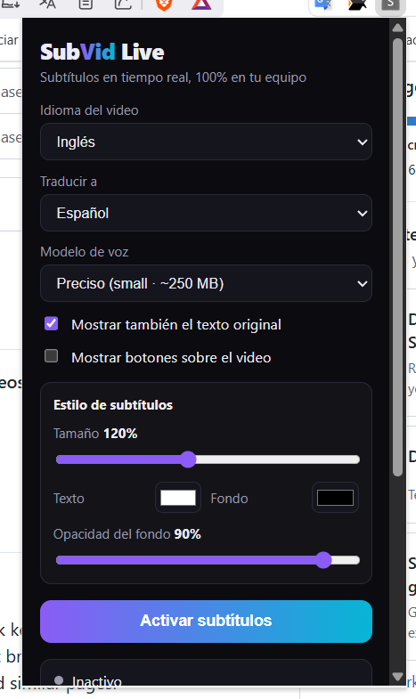
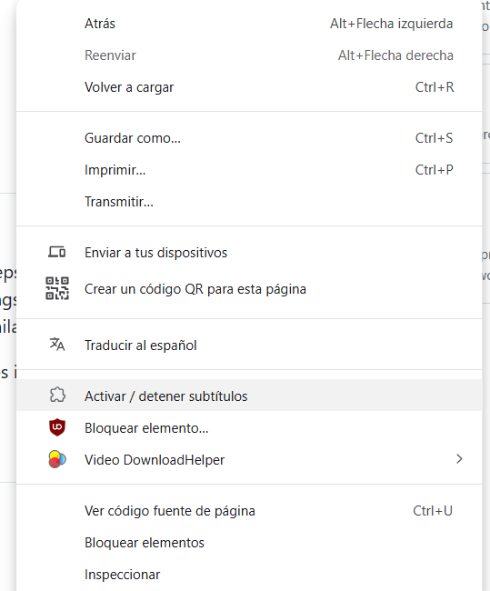
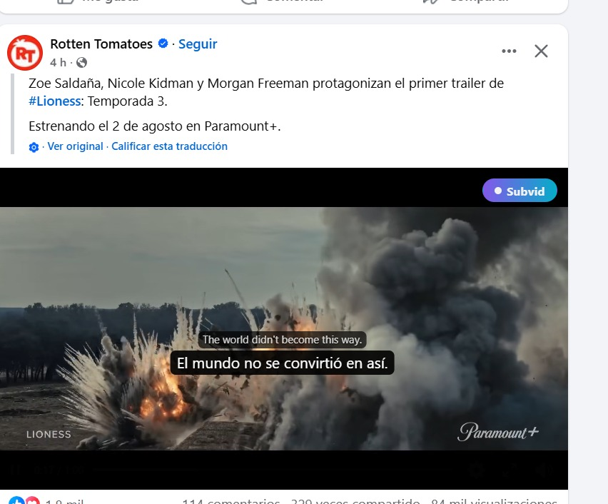

<div align="center">

# SubVid Live Extension

**Real-time local subtitles and translation for web videos.**

No uploads. No backend. No API keys.

[Original project](https://github.com/midudev/subvid.app) ·
[Live site](https://subvid.app) ·
[This fork](https://github.com/jooge1998/subvid-live-extension)

</div>

## About This Fork

This repository is a fork of [midudev/subvid.app](https://github.com/midudev/subvid.app).

The original project is a browser-based subtitle editor for uploaded videos. This fork keeps the original project structure, but adds a new `extension/` package: a Chrome extension prototype that brings the same local-first idea to videos already playing on websites such as YouTube, X, Facebook, Instagram, and similar pages.

The extension captures the active tab audio, transcribes it locally with Whisper, translates it locally when needed, and renders subtitles directly over the video player.

## Extension Features

- Real-time subtitle overlay on web videos.
- Local speech recognition with Whisper via transformers.js.
- Selectable speech model size: `tiny`, `base`, or `small`.
- Local translation with Chrome's built-in Translator API when available.
- Local model fallback for translation when the browser translator is unavailable.
- Original + translated subtitle display.
- Floating `Subvid` button over detected video players.
- Popup controls for:
  - source language
  - target language
  - speech model size
  - original text visibility
  - overlay button visibility
  - subtitle size
  - text color
  - background color
  - background opacity
- Custom extension icon in the toolbar and context menu.

## Screenshots

### Settings panel

Choose source/target language, speech model, subtitle style, and whether to show
overlay controls over the video.



### Context menu

Right-click anywhere on the page → **Activar / detener subtítulos**. This also
grants the `activeTab` permission required for audio capture. The menu shows
the SubVid logo.



### Subtitles on video

Dual-line subtitles (original + translation) rendered over the player. The
floating **Subvid** button toggles subtitles without opening the popup.



More details (in Spanish) in [`extension/README.md`](extension/README.md).

## Privacy

The extension is local-first:

- Video files are not uploaded.
- Audio is captured from the active tab and processed locally in the browser.
- AI models run in browser workers with WASM/WebGPU where available.
- No backend or API keys are required.

Model files are downloaded on first use and cached by the browser.

## Install Locally

```sh
cd extension
npm install
npm run build
```

Then:

1. Open `chrome://extensions`.
2. Enable **Developer mode**.
3. Click **Load unpacked**.
4. Select `extension/dist`.

## Usage

1. Open a page with a video.
2. Click the SubVid Live extension icon.
3. Choose the source language, target language, and model size.
4. Click **Activate subtitles**.
5. Subtitles will appear over the detected video player.

You can also use the floating `Subvid` button over the video after the extension has been invoked on the current tab.

> Chrome requires an extension invocation before tab audio can be captured. Use the extension icon, context menu, or keyboard shortcut first; after that, the floating button can toggle subtitles directly.

## Extension Structure

```text
extension/
├── manifest.config.ts
├── src/
│   ├── background.ts
│   ├── content/
│   │   ├── content.ts
│   │   └── content.css
│   ├── offscreen/
│   │   ├── offscreen.ts
│   │   ├── asr.worker.ts
│   │   └── translation.worker.ts
│   ├── popup/
│   │   ├── popup.html
│   │   ├── popup.ts
│   │   └── popup.css
│   └── shared/
│       ├── languages.ts
│       └── types.ts
└── vite.config.ts
```

## Tech Notes

- `chrome.tabCapture` captures active tab audio.
- `chrome.offscreen` hosts the audio pipeline and model workers.
- The content script renders subtitles over the visible video player.
- The popup manages language, model, and style preferences.
- The extension is built with Vite and Manifest V3.

## Original web app

The upstream app still lives in this repository. It generates, edits, translates, and exports subtitles for any video or audio entirely in the browser.


[](https://astro.build)
[](https://tailwindcss.com)
[](https://huggingface.co/Xenova/whisper-base)
[](https://workers.cloudflare.com)

### What it does

1. **Upload a video or audio** — drag & drop or browse. Supports MP4, MOV, WebM, MKV, MP3, WAV, and OGG.
2. **Configure languages** — pick the audio language (or auto-detect) and the subtitle language.
3. **Generate subtitles** — Whisper transcribes the audio; NLLB translates when needed.
4. **Edit in the timeline** — fix text, timing, and styling with undo/redo.
5. **Export** — download an `.srt` file or a new video with burned-in captions (video files only).

Everything runs client-side. Your files never leave your device.

### Features

- **AI transcription** — [Whisper](https://huggingface.co/Xenova/whisper-base) via [transformers.js](https://huggingface.co/docs/transformers.js), with optional WebGPU acceleration.
- **AI translation** — [NLLB-200](https://huggingface.co/Xenova/nllb-200-distilled-600M) for multilingual subtitle tracks.
- **Subtitle editor** — segment list, timeline scrubbing, multi-language tracks, caption presets (font, color, background, outline, position).
- **Export options**
  - `.srt` subtitle file
  - MP4 with hard-coded subtitles (WebCodecs + [mediabunny](https://github.com/Vanilagy/mediabunny) when available; canvas + MediaRecorder as fallback)
- **Internationalization** — English (default) and Spanish, with static pages per locale.
- **Offline-friendly models** — AI weights are downloaded once and cached in the browser (IndexedDB).
- **Audio-only mode** — upload MP3, WAV, or OGG files to generate subtitle files without needing video.

### Tech stack

| Layer | Technology |
| --- | --- |
| Framework | [Astro 7](https://astro.build) (static site) |
| Styling | [Tailwind CSS 4](https://tailwindcss.com) |
| Speech recognition | [@xenova/transformers](https://www.npmjs.com/package/@xenova/transformers) (Whisper) |
| Translation | transformers.js (NLLB-200) |
| Audio extraction | [@ffmpeg/ffmpeg](https://ffmpegwasm.netlify.app) (WASM) |
| Video export | [mediabunny](https://www.npmjs.com/package/mediabunny) + WebCodecs |
| Deployment | [Cloudflare Workers](https://workers.cloudflare.com) (static assets) |

### Requirements

- **Node.js** ≥ 22.12.0
- **pnpm** (recommended package manager for this repo)

For end users, a modern Chromium-based browser (Chrome, Edge, Brave) or Firefox is recommended. Safari works but WebCodecs export may fall back to the slower MediaRecorder path.

### Getting started

```sh
# Clone the repository
git clone https://github.com/midudev/subvid.app.git
cd subvid.app

# Install dependencies
pnpm install

# Start the dev server (http://localhost:4321)
pnpm dev
```

No environment variables or external services are required for local development.

### Scripts

| Command | Description |
| --- | --- |
| `pnpm dev` | Start Astro dev server at `localhost:4321` |
| `pnpm build` | Build the production site to `./dist/` |
| `pnpm preview` | Preview the production build locally |
| `pnpm preview:cf` | Build and preview with Wrangler (Cloudflare Workers runtime) |
| `pnpm deploy` | Build and deploy to Cloudflare Workers |

### Project structure

```text
src/
├── components/       # Astro UI (upload, config, editor, export modal, …)
├── i18n/ui.ts        # Translations (en, es) — server + client strings
├── layouts/          # HTML shell, hreflang, meta tags
├── pages/            # Routes: / (en), /es/ (es)
├── scripts/
│   ├── app.ts        # Main client logic (state, transcription, export)
│   ├── transcriber.worker.ts  # Web Worker for AI models
│   └── dom.ts        # DOM helpers
└── styles/           # Global and app-specific CSS
```

The app is a multi-stage SPA embedded in static Astro pages. Server-rendered copy lives in `src/i18n/ui.ts`; runtime strings for the active locale are injected into `window.__I18N__` so only one language ships per page.

### Architecture notes

- **Main thread** — UI, video playback, timeline, FFmpeg orchestration, export rendering.
- **Transcriber worker** — loads Whisper/NLLB and runs inference off the main thread so the UI stays responsive.
- **FFmpeg worker** — extracts audio from the uploaded video before transcription.
- **Model downloads** — fetched from Hugging Face on first use (~150 MB for Whisper base + translation model). Progress is shown in the status dock; models can be cleared from the downloads panel.

#### Browser capabilities

| Capability | Used for |
| --- | --- |
| WebGPU | Faster Whisper inference (when supported) |
| WebCodecs | Fast MP4 export with burned-in subtitles |
| SharedArrayBuffer / cross-origin isolation | Required by FFmpeg WASM in some environments |

### Deployment

The site is deployed as static assets on Cloudflare Workers. Configuration lives in `wrangler.jsonc`:

```sh
pnpm deploy
```

You need a [Cloudflare account](https://dash.cloudflare.com) and Wrangler authenticated (`wrangler login`).

### Adding a language

1. Add the locale code to `i18n.locales` in `astro.config.mjs`.
2. Create `src/pages/<code>/index.astro` (copy `src/pages/es/index.astro`).
3. Add a translation block in `src/i18n/ui.ts` mirroring the English keys.
4. Register the display name in `languages` inside `src/i18n/ui.ts`.

### Web app privacy

subvid.app is designed around local-first processing:

- Videos are read from disk via the File API — never uploaded.
- AI models run in Web Workers with WASM/WebGPU.
- No analytics backend or user accounts in this codebase.

## Credits

This work is based on [midudev/subvid.app](https://github.com/midudev/subvid.app), which provides the original local-first subtitle generation and editing app.

## License

See the original repository license for details.

## Author

Built by [midudev](https://midu.dev) and [Contributors](https://github.com/midudev/subvid.app/graphs/contributors).
